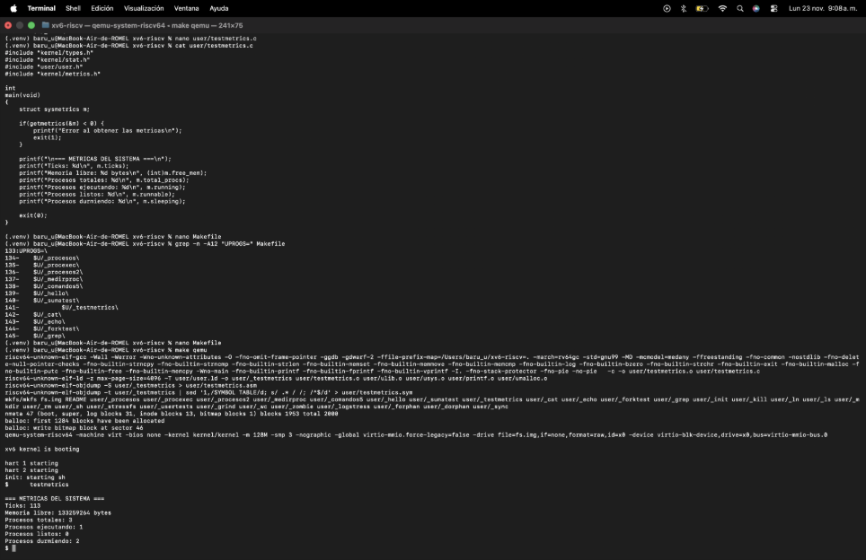
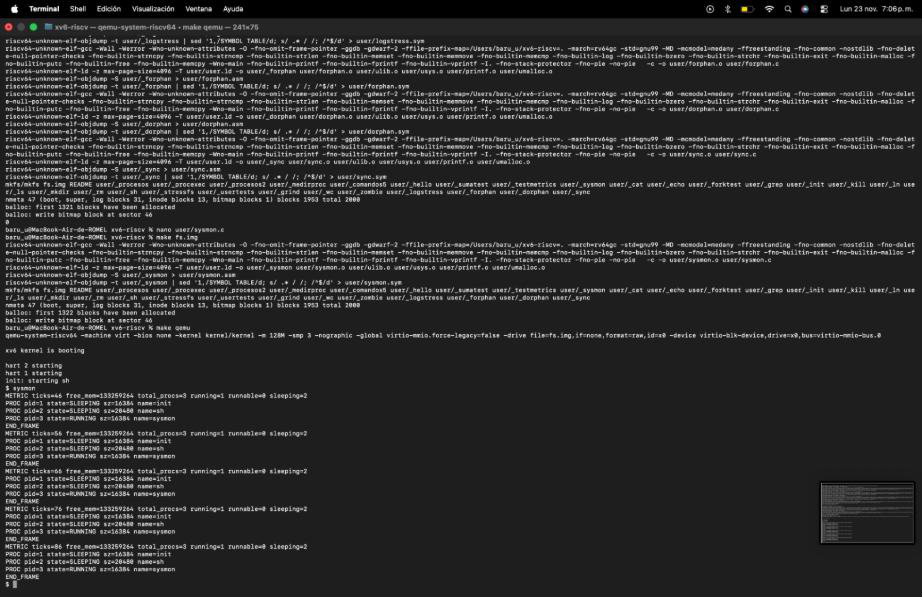
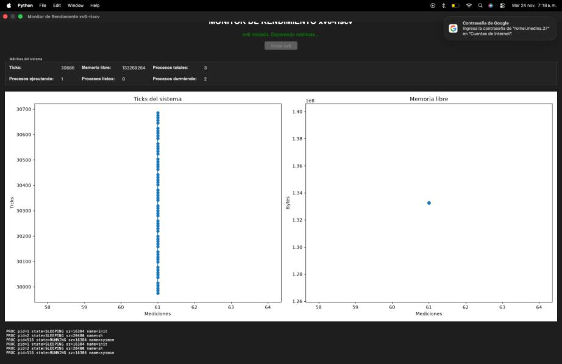
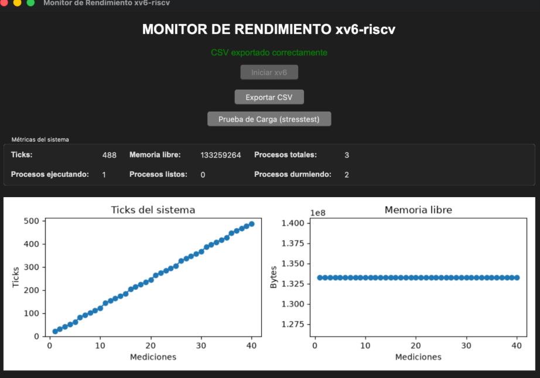
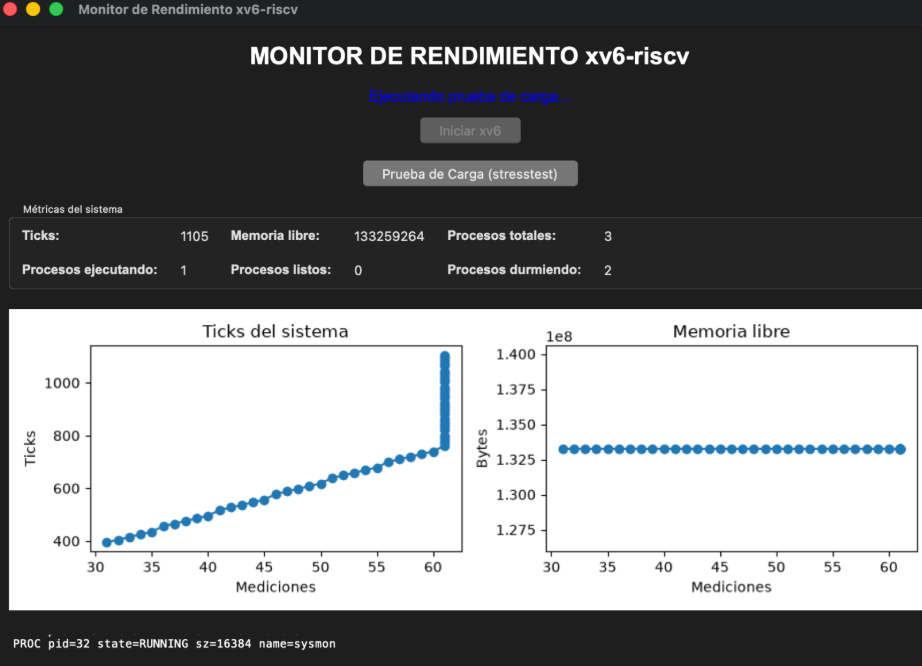
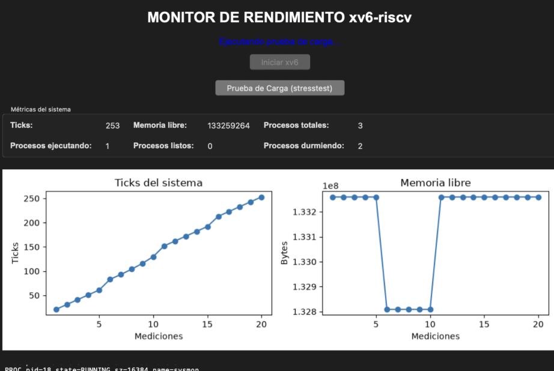

# Guía de implementación del proyecto final: Monitor de Rendimiento en Tiempo Real para xv6-riscv

**Sistemas Operativos · IS-380 · 2026-II**  
Escuela Profesional de Ingeniería de Sistemas — UNSCH

Este proyecto integra una llamada al sistema con un programa de usuario y una interfaz gráfica en Ubuntu. La variante utilizada tiene `pause()` y `copyout()` de cinco argumentos.

> Conversión de la guía original a Markdown. Las imágenes usan rutas relativas a la carpeta `Imagenes`. Los resultados numéricos corresponden a la sesión descrita en la guía y no a una nueva prueba. Los nombres de dos imágenes se adaptaron a la carpeta de evidencias entregada.

## 1.     Planteamiento del proyecto

    El objetivo es construir una herramienta que permita observar el comportamiento interno de
xv6 desde una interfaz gráfica externa, sin depender únicamente de la salida textual de la consola.
El alcance comprende la recolección de métricas, su visualización, una prueba de carga controlada
y la exportación de resultados. El control individual de procesos y el cierre automático se incluyen
como funcionalidades cuya validación final está pendiente.

## 2.     Objetivos

       Implementar la llamada al sistema getmetrics para obtener métricas del kernel.

       Visualizar memoria y estados de procesos mediante Python.

       Comprobar la creación de procesos y la recuperación de recursos con una carga controlada.

       Exportar datos a CSV y comprobar el envío de comandos y la finalización de procesos.

## 3.     Recursos y herramientas

   Ubuntu en WSL2, xv6-riscv preparado, compilador RISC-V, Make, QEMU, Python 3, Tkinter
y Matplotlib.

## 4.     Fundamento teórico

### 4.1.    Métricas del kernel

    Los ticks representan interrupciones temporales contabilizadas por el kernel. La memoria libre
se obtiene recorriendo la lista de páginas libres bajo su bloqueo. Cada página aporta 4096 bytes. El
tamaño de un proceso (sz) representa su espacio de direcciones, no necesariamente su RAM física
residente.

### 4.2.     Estados de los procesos

| Estado | Significado |
|---|---|
| RUNNING | Ejecutándose. |
| RUNNABLE | Listo para ejecutar. |
| SLEEPING | Esperando un evento. |
| ZOMBIE | Finalizado, pendiente de ser recogido por su padre. |
| UNUSED / USED | Entrada libre / reservada. |

### 4.3.     Comunicación entre kernel y monitor

    La syscall copia una estructura de métricas a espacio de usuario. El programa sysmon emite
registros METRIC, PROC y END_FRAME. Python lee la salida de QEMU en un hilo y transfiere
los datos a la interfaz mediante una cola. La interfaz estima la RAM utilizada restando la memoria
libre de 128 MiB; dicha estimación incluye gastos del sistema y no equivale a la suma de los tamaños
de procesos.

## 5.      Implementación del proyecto

### 5.1.     Paso 0: verificar la copia correcta antes de empezar

Nota: En una comprobación posterior se detectó que en /xv6-riscv faltaban kernel/metrics.h
y user/sysmon.c. No se debe presentar una ejecución antigua como si fuera una prueba actual.
Primero recuperar o reconstruir el proyecto y repetir las pruebas.

```bash
cd ~/xv6-riscv
pwd
ls -l kernel/metrics.h user/sysmon.c user/stresstest.c monitor_xv6.py
grep -n 'SYS_getmetrics' kernel/syscall.h
grep -n '_sysmon\|_stresstest' Makefile
find /home/laboratorio -type f \( -name metrics.h -o -name sysmon.c \) 2>/dev/null
```

Si faltan archivos, buscar primero la copia original, revisar git status y git log; no usar git
reset --hard ni sobrescribir cambios sin respaldo. La captura de verificación debe mostrar archivos
presentes, no errores de ausencia.
Captura EV-00 (previa): guardar como 00_verificacion_archivos.png cuando se confirme
que el proyecto está completo.

### 5.2.     Paso 1: preparar el entorno

```bash
cd ~/xv6-riscv
sudo apt update
sudo apt install -y python3-tk python3-matplotlib
grep -n 'copyout' kernel/defs.h
grep -n 'pause' user/user.h
```

Nota: Usar la copia de xv6 de la práctica. No reemplazarla por una versión diferente. Verificar que
la firma de copyout incluye el tamaño del espacio de usuario; comprobar el número de syscall libre
antes de registrarla.

### 5.3.     Paso 2: crear kernel/metrics.h

```bash
nano kernel/metrics.h
```

En nano, guardar con Ctrl+O, Enter y salir con Ctrl+X después de introducir el código indicado.

```c
#ifndef _METRICS_H_
#define _METRICS_H_
#define MAX_PROCS_METRIC 64
struct proc_info {
   int pid;
   int state;
   uint64 sz;
   char name[16];
};
struct sysmetrics {
   uint ticks;
   uint64 free_mem;
   int total_procs;
   int running;
   int runnable;
   int sleeping;
   int proc_count;
   struct proc_info procs[MAX_PROCS_METRIC];
};
#endif
```

```bash
ls -l kernel/metrics.h
cat kernel/metrics.h
```

Comprobar que el archivo existe y contiene la estructura completa. Captura EV-01: mostrar ls
-l kernel/metrics.h y el contenido de la estructura. Guardar 01_estructura_metrics.png.

### 5.4.   Paso 3: modificar el kernel

   kernel/defs.h.

```bash
nano kernel/defs.h
```

En nano, guardar con Ctrl+O, Enter y salir con Ctrl+X después de introducir el código indicado.
Agregar junto a las declaraciones de estructuras, y en las secciones kalloc.c y proc.c, respectivamente:

```c
struct sysmetrics;
uint64 kfreemem(void);
void get_proc_stats(struct sysmetrics *);
```

kernel/kalloc.c.

```bash
nano kernel/kalloc.c
```

En nano, guardar con Ctrl+O, Enter y salir con Ctrl+X después de introducir el código indicado.
Agregar al final:

```c
uint64
kfreemem(void)
{
  struct run *r;
  uint64 free_bytes = 0;
  acquire(&kmem.lock);
  for(r = kmem.freelist; r; r = r->next)
    free_bytes += PGSIZE;
  release(&kmem.lock);
  return free_bytes;
}
```

kernel/proc.c.

```bash
nano kernel/proc.c
```

En nano, guardar con Ctrl+O, Enter y salir con Ctrl+X después de introducir el código indicado.
Agregar después de la inclusión de proc.h:

```c
#include "metrics.h"
```

Al final del archivo:

```c
void
get_proc_stats(struct sysmetrics *m)
{
  struct proc *p;
  int idx = 0;
  m->total_procs = m->running = m->runnable = 0;
  m->sleeping = m->proc_count = 0;
  for(p = proc; p < &proc[NPROC]; p++){
     acquire(&p->lock);
     if(p->state != UNUSED){
       m->total_procs++;
       if(p->state == RUNNING) m->running++;
       else if(p->state == RUNNABLE) m->runnable++;
       else if(p->state == SLEEPING) m->sleeping++;
       if(idx < MAX_PROCS_METRIC){
         m->procs[idx].pid = p->pid;
         m->procs[idx].state = p->state;
         m->procs[idx].sz = p->sz;
         safestrcpy(m->procs[idx].name, p->name,
                    sizeof(m->procs[idx].name));
         idx++;
       }
     }
     release(&p->lock);
  }
  m->proc_count = idx;
}
```

kernel/sysproc.c.

```bash
nano kernel/sysproc.c
```

En nano, guardar con Ctrl+O, Enter y salir con Ctrl+X después de introducir el código indicado.
Incluir metrics.h después de proc.h y agregar al final:

```c
#include "metrics.h"
uint64
sys_getmetrics(void)
{
  uint64 addr;
  struct sysmetrics *m;
  struct proc *p = myproc();
  argaddr(0, &addr);
  m = (struct sysmetrics *)kalloc();
  if(m == 0) return -1;
  memset(m, 0, sizeof(*m));
  acquire(&tickslock);
  m->ticks = ticks;
  release(&tickslock);
  m->free_mem = kfreemem();
  get_proc_stats(m);
    if(copyout(p->pagetable, addr, p->sz,
               (char *)m, sizeof(*m)) < 0){
      kfree(m);
      return -1;
    }
    kfree(m);
    return 0;
}
```

Nota: Confirmar el orden de los argumentos en la definición de copyout de kernel/vm.c: este bloque
presupone el orden pagetable, dirección destino, tamaño del proceso, origen y longitud. La captura
de compilación confirma cinco argumentos, pero no muestra sus nombres. No duplicar declaraciones
existentes.

```bash
grep -n "^copyout(" kernel/vm.c
grep -n SYS_ kernel/syscall.h
nano kernel/syscall.h
```

Registrar la syscall. En kernel/syscall.h (29 fue el número asignado en la práctica):

```c
#define SYS_getmetrics 29
```

```bash
nano kernel/syscall.c
```

En kernel/syscall.c, junto a los extern y dentro de la tabla syscalls, respectivamente:

```c
extern uint64 sys_getmetrics(void);
[SYS_getmetrics] sys_getmetrics,
```

```bash
nano user/usys.pl
```

En user/usys.pl:

```c
entry("getmetrics");
```

```bash
nano user/user.h
```

En user/user.h, junto a las estructuras y prototipos:

```c
struct sysmetrics;
int getmetrics(struct sysmetrics*);
```

```bash
grep -n 'getmetrics\|kfreemem\|get_proc_stats' \
kernel/defs.h kernel/kalloc.c kernel/proc.c \
kernel/sysproc.c kernel/syscall.h kernel/syscall.c \
user/usys.pl user/user.h
```

Resultado observado: syscall 29 registrada en los archivos correspondientes. Captura EV-02: tomar
captura del resultado de grep con getmetrics en syscall.h, syscall.c, usys.pl y user.h.
Guardar 02_registro_syscall.png.

### 5.5.    Paso 4: crear los programas de usuario

     Crear user/sysmon.c:

```bash
nano user/sysmon.c
```

En nano, guardar con Ctrl+O, Enter y salir con Ctrl+X después de introducir el código indicado.

```c
#include "kernel/types.h"
#include "kernel/stat.h"
#include "kernel/metrics.h"
#include "user/user.h"
static struct sysmetrics m;
static char *states[] = {
   [0] = "UNUSED", [1] = "USED",
   [2] = "SLEEPING", [3] = "RUNNABLE",
   [4] = "RUNNING", [5] = "ZOMBIE"
};
int main(int argc, char *argv[])
{
   while(1){
     if(getmetrics(&m) == 0){
       printf("METRIC| %d| %d| %d| %d| %d| %d\n",
              m.ticks, (int)(m.free_mem / 1024),
              m.total_procs, m.running, m.runnable,
              m.sleeping);
       for(int i = 0; i < m.proc_count; i++){
         int st = m.procs[i].state;
         char *name = st >= 0 && st <= 5 ? states[st] : "UNKNOWN";
         printf("PROC| %d| %s| %d| %s\n", m.procs[i].pid,
                name, (int)(m.procs[i].sz / 1024),
                m.procs[i].name);
       }
       printf("END_FRAME\n");
     }
     pause(10);
   }
   exit(0);
}
```

Crear user/stresstest.c:

```bash
nano user/stresstest.c
```

En nano, guardar con Ctrl+O, Enter y salir con Ctrl+X después de introducir el código indicado.

```c
#include "kernel/types.h"
#include "kernel/stat.h"
#include "user/user.h"
int main(int argc, char *argv[])
{
  int hijos = 0;
  printf("Iniciando prueba de carga...\n");
  for(int i = 0; i < 10; i++){
    int pid = fork();
    if(pid < 0) break;
    if(pid == 0){
      pause(500);
      exit(0);
    }
    hijos++;
  }
  for(int i = 0; i < hijos; i++) wait(0);
  printf("Prueba de carga finalizada\n");
  exit(0);
}
```

```bash
nano Makefile
```

Agregar a la lista UPROGS del Makefile, sin duplicar entradas:

```text
       $U/_sysmon\
       $U/_stresstest\
```

Comprobar que user/kill.c existe y que su entrada está registrada en la misma lista; si existe pero
falta la entrada, agregarla:

```text
       $U/_kill\
```

```bash
ls -l user/sysmon.c user/stresstest.c
grep -nE '_sysmon|_stresstest|_kill' Makefile
```

### 5.6.     Paso 5: compilar y verificar

```bash
make clean && make && make fs.img
echo $?
```

El código de salida esperado es 0. Captura CP-01: tomar captura inmediatamente después de echo
$?, mostrando el valor 0 y las últimas líneas de compilación. Guardar 03_compilacion.png.
Si aparece otro valor, registrar el error y corregir antes de continuar. Después de comprobar el código
de salida, iniciar QEMU desde Ubuntu:

```bash
make qemu
```

Cuando aparezca el prompt de xv6, ejecutar:

```bash
sysmon
```

Deben aparecer registros METRIC, PROC y END_FRAME repetidamente. Para salir de QEMU,
pulsar Ctrl+a y luego x. Salida observada de sysmon (ejemplo de la sesión):

```bash
METRIC|107|130120|3|1|0|2
PROC|1|SLEEPING|16|init
PROC|2|SLEEPING|20|sh
PROC|3|RUNNING|16|sysmon
END_FRAME
```

Captura CP-02: mostrar el comando sysmon y al menos un bloque completo METRIC, PROC,
END_FRAME. Guardar 04_ejecucion_sysmon.png. Los valores son ilustrativos; capturar los valores
reales.

### 5.7.     Paso 6: crear la interfaz gráfica

    Copiar el archivo monitor_xv6.py completo del anexo a la raíz de xv6-riscv. La versión consoli-
dada usa stresstest en segundo plano, conserva la selección en la tabla y cancela las actualizaciones
al cerrar. Se verificó la sintaxis Python de esta versión; las últimas modificaciones requieren prueba
funcional en Ubuntu.

```bash
python3 -m py_compile monitor_xv6.py
```

```bash
cd ~/xv6-riscv
ls -l monitor_xv6.py
python3 -m py_compile monitor_xv6.py
```

Si el archivo no está presente, crearlo con nano y pegar el código completo del anexo, o copiar el
archivo Python incluido en el ZIP desde Windows a la carpeta de WSL.

### 5.8.     Paso 7: ejecutar el proyecto

```bash
cd ~/xv6-riscv
python3 monitor_xv6.py
```

#### 5.8.1.    Ejecución 1: observar el estado inicial

    Esperar la aparición de init, sh y sysmon. Comprobar que los ticks aumentan y que la memoria
libre se mantiene aproximadamente en 130120 KB. Captura CP-03: mostrar simultáneamente
ticks, RAM libre, dos gráficas y tabla de procesos. Guardar 05_monitor_inicial.png.

#### 5.8.2.    Ejecución 2: generar carga

   Pulsar el botón Prueba de Carga (stresstest). El comando enviado a xv6 es:

```bash
stresstest &
```

Comprobar el aumento de 3 a 14 procesos, con diez hijos y un padre adicionales. Esperar unos
500 ticks y comprobar la recuperación de la memoria y de los tres procesos iniciales. La ejecución
de carga fue verificada; el cambio posterior al segundo plano requiere comprobación adicional.
Captura CP-04: capturar inmediatamente cuando aparezcan los procesos stresstest y suba la
gráfica; guardar 06_prueba_carga.png. Captura CP-05: esperar el fin de la carga y capturar
la gráfica descendente y el retorno a tres procesos; guardar 07_recuperacion.png. No
inventar valores si cambian.

#### 5.8.3.    Ejecución 3: finalizar un proceso

    Volver a pulsar la prueba de carga, seleccionar un hijo de stresstest y pulsar Matar Proceso
Seleccionado. El comando enviado será, por ejemplo:

```bash
kill 28
```

El PID es ilustrativo: usar el PID real de la tabla. Debe desaparecer el hijo o pasar temporalmente
a ZOMBIE. No seleccionar init, sh original ni sysmon. Verificar que kill esté incluido en fs.img. Esta
prueba queda pendiente de confirmación tras la corrección. Captura opcional: solo si se verifica
el cambio de estado o desaparición del PID, guardar 09_kill_verificado.png. Si falla, conservar
el error como incidencia, no como éxito.

#### 5.8.4.    Ejecución 4: exportar CSV

    Pulsar Exportar CSV, elegir una ubicación y abrir el archivo. En Excel utilizar Datos, Texto en
columnas, Delimitados, Coma, Finalizar. La exportación fue comprobada. Captura CP-06: abrir
el CSV en Excel y mostrar encabezados y varias filas; guardar 08_exportacion_csv.png. Conservar
también el archivo .csv original.

#### 5.8.5.    Ejecución 5: cerrar y volver a iniciar

   Pulsar la X de la ventana. Se espera recuperar el prompt de Ubuntu automáticamente. Com-
probar desde Ubuntu:

```bash
ps aux | grep -E '[m]onitor_xv6.py|[q]emu-system-riscv64'
```

Si no hay otra sesión activa, no debe aparecer ningún proceso de este tipo. Volver a iniciar con

```bash
python3 monitor_xv6.py. La corrección de cierre requiere validación. Captura opcional: si el cierre
```

funciona, mostrar el comando ps sin procesos QEMU/monitor activos y guardar 10_cierre_verificado.png.

## 6.      Resultados y evidencias

| Indicador | Antes | Durante | Después |
|---|---:|---:|---:|
| Procesos | 3 | 14 | 3 |
| RAM libre (KB) | 130120 | 129680 | 130120 |
| RAM utilizada (MiB, aprox.) | 0.93 | 1.36 | 0.93 |
| RUNNABLE | 0 | 10 | 0 |

    Se observaron 11 procesos adicionales (padre y diez hijos), con una reducción de 440 KB de
memoria libre, recuperada al terminar. La compilación, las métricas, la carga y el CSV fueron
comprobados en la sesión. La finalización individual mediante kill y el cierre automático tras las
últimas correcciones quedan pendientes de verificación; no se presentan como pruebas superadas.
Nota: Registrar capturas propias de compilación, monitor inicial, carga, recuperación, CSV y,
cuando se comprueben, kill y cierre.

### 6.1. Capturas de ejecución













## 7.     Protocolo formal de evidencias para la entrega

### 7.1.    Casos de prueba exigidos por el docente

Cada caso debe tener objetivo, entrada o acción, resultado esperado, resultado real observado, fecha, responsable y evidencia. Solo marcar aprobado después de repetir la prueba en la copia final del repositorio.

| Caso | Acción | Evidencia |
|---|---|---|
| CP-01 | Compilar y comprobar código 0 | 03_compilacion.png |
| CP-02 | Ejecutar sysmon y observar METRIC y PROC | 04_ejecucion_sysmon.png |
| CP-03 | Abrir GUI y observar ticks, memoria y procesos | 05_monitor_inicial.png |
| CP-04 | Ejecutar stresstest & y observar incremento | 06_prueba_carga.png |
| CP-05 | Esperar fin de carga y comprobar recuperación | 07_recuperacion.png |
| CP-06 | Exportar CSV y comprobar filas y columnas | 08_exportacion_csv.png |

### 7.2.    Ficha para registrar cada prueba

       Identificador y objetivo: CP-01, CP-02, etc.; indicar qué requisito verifica.
       Entrada: comando exacto, botón pulsado, condiciones iniciales y versión de código.
       Resultado esperado: comportamiento que debe observarse antes de ejecutar.
       Resultado obtenido: copiar valores reales de la captura; no usar cifras históricas como si
       fueran actuales.
       Estado: aprobado / fallido / pendiente; anotar errores y correcciones si los hubo.
       Evidencia: nombre del PNG y, cuando corresponda, archivo CSV y commit asociado.

### 7.3.     Guardar capturas y organizar GitHub

  Crear la estructura obligatoria dentro del repositorio y abrir la carpeta en el explorador de
Windows:

```bash
cd ~/xv6-riscv
mkdir -p documento_TrabajoFinal/05_Evidencias
mkdir -p documento_TrabajoFinal/06_Resultados
explorer.exe documento_TrabajoFinal/05_Evidencias
```

Para cada captura pulsar Windows + Shift + S, seleccionar el área que muestre comando y
resultado, y guardar con el nombre indicado. Evitar recortar el mensaje de salida, editar números
o reutilizar una captura de una prueba distinta. Incluir fecha o sesión de ejecución en la ficha de
pruebas.
Estructura de entrega recomendada:

```text
documento_TrabajoFinal/
  01_Trabajo_Monografico.pdf
  02_Presentacion_TrabajoFinal.pptx
  03_Guia_Implementacion_Con_Evidencias.pdf
  Imagenes/
    00_verificacion_archivos.png
    01_estructura_metrics.png
    02_registro_syscall.png
    03_compilacion.png
    04_ejecucion_sysmon.png
    05_monitor_inicial.png
    06_prueba_carga.png
    07_recuperacion.png
    08_exportacion_csv.png
  06_Resultados/
    xv6_metrics.csv
```

Nota: La guía y las capturas no sustituyen la monografía completa ni el PPT. El README debe
documentar instalación, compilación, ejecución y pruebas. Cada integrante debe realizar aportes y
commits propios verificables; no fabricar historial. Se exige sustentación en vivo y publicación de
LinkedIn con evidencias reales y enlace al repositorio.

```bash
cd ~/xv6-riscv
git status
git remote -v
git log --oneline -8
git add documento_TrabajoFinal/
git commit -m "Documentar pruebas y evidencias del trabajo final"
git push
```

Verificar en la web de GitHub que todos los archivos se abren y que los integrantes aparecen en
el historial. Ejecutar el commit solo cuando haya cambios propios preparados y confirmar la rama
remota correcta.

## 8.      Preguntas para la sustentación

## 1. ¿Por qué aparecen 14 procesos si la prueba crea diez hijos?

## 2. ¿Cuánta memoria libre se perdió durante la carga y qué ocurrió al finalizar?

## 3. ¿Por qué se utiliza kalloc para alojar la estructura de métricas?

## 4. ¿Por qué debe ejecutarse la prueba de carga en segundo plano para enviar kill desde el monitor?

## 5. ¿Qué diferencia existe entre el tamaño virtual de un proceso y su memoria física residente?

## 9.      Conclusiones

    La implementación permitió observar el incremento de 3 a 14 procesos durante la prueba de
carga, así como la recuperación de 440 KB de memoria libre al concluir. Los resultados confirman el
funcionamiento de la recolección y visualización de métricas y la liberación de recursos en el escenario
evaluado. Para completar la validación del proyecto se deben comprobar las últimas modificaciones
del control de procesos y del cierre automático.

## Referencias

   MIT PDOS. xv6-riscv. https://github.com/mit-pdos/xv6-riscv.
Python. Documentación de tkinter y subprocess. https://docs.python.org/3/.
Matplotlib. Documentación. https://matplotlib.org/.


## Anexo A. Código completo del monitor Python

Código tomado del archivo Python original adjunto, para evitar errores de extracción del PDF. Guardar como `monitor_xv6.py` en la raíz de xv6-riscv.

```python
import os
import signal
import csv
import queue
import subprocess
import threading
import tkinter as tk
from collections import deque
from datetime import datetime
from tkinter import filedialog, messagebox, ttk

import matplotlib.pyplot as plt
from matplotlib.backends.backend_tkagg import FigureCanvasTkAgg

MAX_POINTS = 60
TOTAL_MEM_KB = 128 * 1024  # 128 MB por defecto en xv6-riscv


class XV6MonitorApp:
    def __init__(self, root):
        self.root = root
        self.root.title("Monitor de Rendimiento en Tiempo Real - xv6-riscv")
        self.root.geometry("1150x600")

        self.frame_queue = queue.Queue()
        self.running = True
        self.update_job = None
        self.qemu_proc = None

        self.ticks_data = deque(maxlen=MAX_POINTS)
        self.mem_used_data = deque(maxlen=MAX_POINTS)
        self.procs_data = deque(maxlen=MAX_POINTS)
        self.full_history = []

        self._build_ui()
        self._start_xv6()
        self._update_loop()

    def _build_ui(self):
        # 1. Barra Superior (KPIs y acciones)
        top_frame = ttk.Frame(self.root, padding=10)
        top_frame.pack(fill=tk.X)

        self.lbl_ticks = ttk.Label(top_frame, text="Ticks: 0", font=("Consolas", 11, "bold"))
        self.lbl_ticks.pack(side=tk.LEFT, padx=10)

        self.lbl_mem = ttk.Label(top_frame, text="RAM Libre: 0 KB", font=("Consolas", 11, "bold"))
        self.lbl_mem.pack(side=tk.LEFT, padx=10)

        self.lbl_procs = ttk.Label(
            top_frame,
            text="Procesos: 0 (Run: 0 | Ready: 0 | Sleep: 0)",
            font=("Consolas", 11, "bold"),
        )
        self.lbl_procs.pack(side=tk.LEFT, padx=10)

        ttk.Button(top_frame, text="Exportar CSV", command=self._export_csv).pack(side=tk.RIGHT, padx=5)
        ttk.Button(top_frame, text="Prueba de Carga (stresstest)", command=self._send_stress).pack(side=tk.RIGHT, padx=5)

        # 2. Panel Principal Dividido
        main_pane = ttk.PanedWindow(self.root, orient=tk.HORIZONTAL)
        main_pane.pack(fill=tk.BOTH, expand=True, padx=10, pady=5)

        # Izquierda: Gráficas
        chart_frame = ttk.Frame(main_pane)
        main_pane.add(chart_frame, weight=3)

        self.fig, (self.ax_mem, self.ax_proc) = plt.subplots(2, 1, figsize=(6.5, 5.5), dpi=100)
        self.fig.tight_layout(pad=3.0)
        self.canvas = FigureCanvasTkAgg(self.fig, master=chart_frame)
        self.canvas.get_tk_widget().pack(fill=tk.BOTH, expand=True)

        # Derecha: Tabla de procesos estilo htop
        proc_frame = ttk.LabelFrame(main_pane, text="Tabla de Procesos Activos (xv6)", padding=8)
        main_pane.add(proc_frame, weight=2)

        table_container = ttk.Frame(proc_frame)
        table_container.pack(fill=tk.BOTH, expand=True)

        cols = ("pid", "name", "state", "mem")
        self.tree = ttk.Treeview(table_container, columns=cols, show="headings", selectmode="browse")
        self.tree.heading("pid", text="PID")
        self.tree.heading("name", text="Nombre")
        self.tree.heading("state", text="Estado")
        self.tree.heading("mem", text="Mem (KB)")
        self.tree.column("pid", width=55, anchor=tk.CENTER)
        self.tree.column("name", width=110, anchor=tk.W)
        self.tree.column("state", width=95, anchor=tk.CENTER)
        self.tree.column("mem", width=85, anchor=tk.E)

        self.tree.tag_configure("RUNNING", background="#dcfce7")
        self.tree.tag_configure("RUNNABLE", background="#fef9c3")
        self.tree.tag_configure("SLEEPING", background="#f1f5f9")
        self.tree.tag_configure("ZOMBIE", background="#fee2e2")

        scrollbar = ttk.Scrollbar(table_container, orient=tk.VERTICAL, command=self.tree.yview)
        self.tree.configure(yscrollcommand=scrollbar.set)
        self.tree.pack(side=tk.LEFT, fill=tk.BOTH, expand=True)
        scrollbar.pack(side=tk.RIGHT, fill=tk.Y)

        proc_ctrl = ttk.Frame(proc_frame, padding=(0, 8, 0, 0))
        proc_ctrl.pack(fill=tk.X)
        ttk.Button(proc_ctrl, text="Matar Proceso Seleccionado (kill)", command=self._kill_selected).pack(fill=tk.X)

        # 3. Barra Inferior: Consola rápida hacia xv6
        cmd_frame = ttk.Frame(self.root, padding=(10, 5, 10, 10))
        cmd_frame.pack(fill=tk.X)
        ttk.Label(cmd_frame, text="Comando xv6:").pack(side=tk.LEFT, padx=(0, 8))
        self.cmd_entry = ttk.Entry(cmd_frame)
        self.cmd_entry.pack(side=tk.LEFT, fill=tk.X, expand=True, padx=(0, 8))
        self.cmd_entry.bind("<Return>", lambda _e: self._send_custom_command())
        ttk.Button(cmd_frame, text="Enviar", command=self._send_custom_command).pack(side=tk.RIGHT)

    def _start_xv6(self):
        try:
            self.qemu_proc = subprocess.Popen(
                ["make", "qemu"],
                stdin=subprocess.PIPE,
                stdout=subprocess.PIPE,
                stderr=subprocess.STDOUT,
                text=True,
                bufsize=1,
                start_new_session=True,
            )
            threading.Thread(target=self._read_qemu_output, daemon=True).start()
        except Exception as e:
            messagebox.showerror("Error al iniciar QEMU", f"No se pudo ejecutar 'make qemu':\n{e}")

    def _read_qemu_output(self):
        sysmon_started = False
        current_metric = None
        current_procs = []

        for line in self.qemu_proc.stdout:
            if not self.running:
                break
            line = line.strip()

            if not sysmon_started and "init: starting sh" in line:
                self._write_to_xv6("sysmon &")
                sysmon_started = True

            if line.startswith("METRIC|"):
                parts = line.split("|")
                if len(parts) == 7:
                    try:
                        current_metric = {
                            "ticks": int(parts[1]),
                            "free_kb": int(parts[2]),
                            "total": int(parts[3]),
                            "running": int(parts[4]),
                            "runnable": int(parts[5]),
                            "sleeping": int(parts[6]),
                        }
                        current_procs = []
                    except ValueError:
                        current_metric = None

            elif line.startswith("PROC|") and current_metric is not None:
                parts = line.split("|")
                if len(parts) == 5:
                    try:
                        current_procs.append({
                            "pid": int(parts[1]),
                            "state": parts[2],
                            "mem_kb": int(parts[3]),
                            "name": parts[4],
                        })
                    except ValueError:
                        pass

            elif line == "END_FRAME" and current_metric is not None:
                self.frame_queue.put((current_metric, current_procs))
                current_metric = None
                current_procs = []

    def _write_to_xv6(self, command):
        if self.qemu_proc and self.qemu_proc.stdin and self.qemu_proc.poll() is None:
            try:
                self.qemu_proc.stdin.write(command + "\n")
                self.qemu_proc.stdin.flush()
            except OSError:
                pass

    def _send_stress(self):
        self._write_to_xv6("stresstest &")

    def _send_custom_command(self):
        cmd = self.cmd_entry.get().strip()
        if cmd:
            self._write_to_xv6(cmd)
            self.cmd_entry.delete(0, tk.END)

    def _kill_selected(self):
        selected = self.tree.selection()
        if not selected:
            messagebox.showwarning("Sin selección", "Selecciona un proceso de la tabla primero.")
            return

        values = self.tree.item(selected[0], "values")
        pid = int(values[0])
        name = values[1]

        if pid in (1, 2) or name == "sysmon":
            confirm = messagebox.askyesno(
                "Proceso crítico",
                f"El proceso '{name}' (PID {pid}) es esencial en xv6. ¿Seguro que deseas matarlo?",
            )
            if not confirm:
                return

        self._write_to_xv6(f"kill {pid}")

    def _export_csv(self):
        if not self.full_history:
            messagebox.showinfo("Sin datos", "Aún no hay métricas registradas para exportar.")
            return

        default_name = f"xv6_metrics_{datetime.now().strftime('%Y%m%d_%H%M%S')}.csv"
        filepath = filedialog.asksaveasfilename(
            defaultextension=".csv",
            initialfile=default_name,
            filetypes=[("Archivo CSV", "*.csv")],
            title="Guardar historial de métricas",
        )
        if not filepath:
            return

        try:
            with open(filepath, mode="w", newline="", encoding="utf-8") as f:
                writer = csv.DictWriter(
                    f,
                    fieldnames=[
                        "timestamp",
                        "ticks",
                        "ram_used_mb",
                        "ram_free_kb",
                        "total_procs",
                        "running",
                        "runnable",
                        "sleeping",
                    ],
                )
                writer.writeheader()
                writer.writerows(self.full_history)
            messagebox.showinfo(
                "Exportación exitosa",
                f"Se guardaron {len(self.full_history)} registros en:\n{filepath}",
            )
        except Exception as e:
            messagebox.showerror("Error al exportar", f"No se pudo guardar el archivo:\n{e}")

    def _update_loop(self):
        latest_frame = None

        while not self.frame_queue.empty():
            m, procs = self.frame_queue.get()
            used_kb = max(0, TOTAL_MEM_KB - m["free_kb"])
            used_mb = round(used_kb / 1024.0, 2)

            self.ticks_data.append(m["ticks"])
            self.mem_used_data.append(used_mb)
            self.procs_data.append(m["total"])

            self.full_history.append({
                "timestamp": datetime.now().strftime("%H:%M:%S"),
                "ticks": m["ticks"],
                "ram_used_mb": used_mb,
                "ram_free_kb": m["free_kb"],
                "total_procs": m["total"],
                "running": m["running"],
                "runnable": m["runnable"],
                "sleeping": m["sleeping"],
            })
            latest_frame = (m, procs)

        if latest_frame is not None:
            m, procs = latest_frame
            self.lbl_ticks.config(text=f"Ticks: {m['ticks']}")
            self.lbl_mem.config(text=f"RAM Libre: {m['free_kb']:,} KB")
            self.lbl_procs.config(
                text=f"Procesos: {m['total']} (Run: {m['running']} | Ready: {m['runnable']} | Sleep: {m['sleeping']})"
            )
            self._refresh_process_table(procs)
            self._redraw_charts()

        if self.running:
            self.update_job = self.root.after(200, self._update_loop)

    def _refresh_process_table(self, procs):
        selected_pid = None
        sel = self.tree.selection()
        if sel:
            selected_pid = self.tree.item(sel[0], "values")[0]

        self.tree.delete(*self.tree.get_children())
        for p in procs:
            tag = p["state"] if p["state"] in ("RUNNING", "RUNNABLE", "SLEEPING", "ZOMBIE") else ""
            item_id = self.tree.insert(
                "",
                tk.END,
                values=(p["pid"], p["name"], p["state"], p["mem_kb"]),
                tags=(tag,),
            )
            if selected_pid is not None and str(p["pid"]) == str(selected_pid):
                self.tree.selection_set(item_id)

    def _redraw_charts(self):
        x = list(self.ticks_data)

        self.ax_mem.clear()
        self.ax_mem.plot(x, list(self.mem_used_data), color="#2563eb", linewidth=2)
        self.ax_mem.fill_between(x, list(self.mem_used_data), color="#93c5fd", alpha=0.3)
        self.ax_mem.set_title("Uso de Memoria RAM en xv6 (MB)")
        self.ax_mem.set_ylabel("MB")
        self.ax_mem.grid(True, linestyle="--", alpha=0.5)

        self.ax_proc.clear()
        self.ax_proc.plot(x, list(self.procs_data), color="#16a34a", linewidth=2, marker="o", markersize=3)
        self.ax_proc.set_title("Procesos Activos en Tabla de Procesos")
        self.ax_proc.set_xlabel("Ticks del Kernel")
        self.ax_proc.set_ylabel("Cantidad")
        self.ax_proc.grid(True, linestyle="--", alpha=0.5)

        self.canvas.draw()

    def on_close(self):
        self.running = False
        if self.update_job is not None:
            self.root.after_cancel(self.update_job)
            self.update_job = None

        if self.qemu_proc:
            try:
                os.killpg(self.qemu_proc.pid, signal.SIGTERM)
                self.qemu_proc.wait(timeout=2)
            except subprocess.TimeoutExpired:
                try:
                    os.killpg(self.qemu_proc.pid, signal.SIGKILL)
                except ProcessLookupError:
                    pass
                self.qemu_proc.wait()
            except ProcessLookupError:
                pass

        plt.close(self.fig)
        self.root.quit()
        self.root.destroy()


if __name__ == "__main__":
    root = tk.Tk()
    app = XV6MonitorApp(root)
    root.protocol("WM_DELETE_WINDOW", app.on_close)
    root.mainloop()
```
