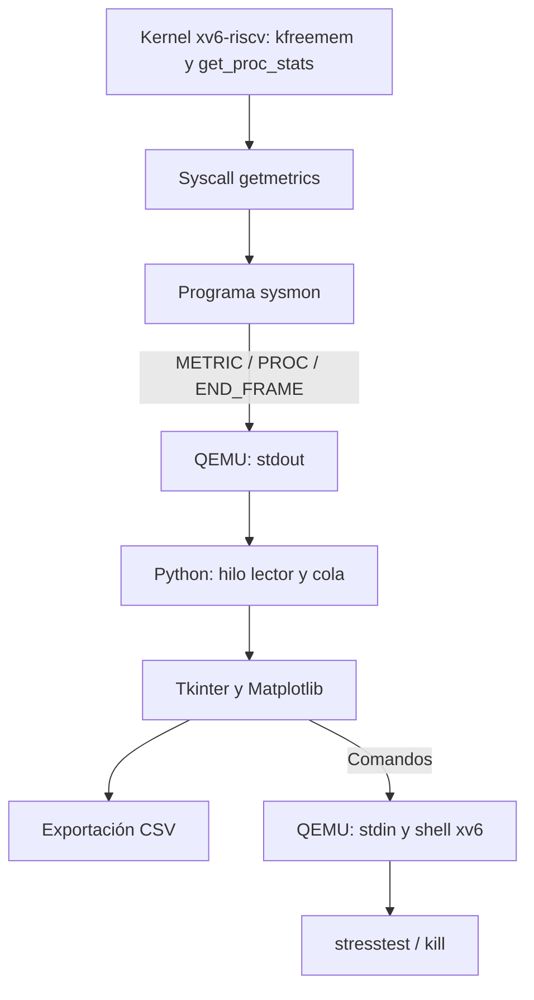

# Monitor de Rendimiento en Tiempo Real para xv6-riscv

   

**Universidad Nacional de San Cristóbal de Huamanga (UNSCH)**  
Facultad de Ingeniería de Minas, Geología y Civil  
Escuela Profesional de Ingeniería de Sistemas  
Curso: Sistemas Operativos (IS-380) | Semestre: 2026-II  
Docente: Ing. Lizbeth Jaico Quispe

## Descripción

Proyecto final que extiende el sistema operativo educativo xv6-riscv mediante una nueva llamada al sistema, `getmetrics()`, y un monitor gráfico externo desarrollado en Python. Permite observar los procesos, sus estados, la memoria física libre y los ticks del kernel durante la ejecución de xv6 en QEMU, así como conservar las mediciones en CSV.


## Problema y justificación

La consola de xv6 muestra lecturas sucesivas que dificultan identificar los cambios de memoria y procesos durante una carga. El monitor reúne estas mediciones en una interfaz visual y permite comparar el comportamiento del sistema antes, durante y después de una prueba controlada. Su finalidad es educativa: relacionar la teoría de sistemas operativos con el funcionamiento del kernel.

## Objetivos

**General:** desarrollar y evaluar un monitor de rendimiento en tiempo real para xv6-riscv.

**Específicos:**

- Implementar `getmetrics()` para recopilar métricas del kernel.
- Visualizar las métricas mediante una interfaz gráfica y exportar el historial a CSV.
- Evaluar los cambios en procesos y memoria libre durante una prueba de carga controlada.

## Funcionalidades

- Consulta de ticks, memoria libre y cantidad de procesos.
- Tabla de procesos con PID, nombre, estado y tamaño del espacio de direcciones.
- Gráficas dinámicas de memoria utilizada estimada y cantidad de procesos.
- Prueba de carga con `stresstest`, que crea diez procesos hijos.
- Exportación de mediciones a CSV.
- Envío de comandos a la shell de xv6 desde la interfaz.
- Control individual mediante `kill` y cierre automático de QEMU implementados, pendientes de validación final.

## Arquitectura




La syscall recopila las métricas y las copia al espacio de usuario mediante `copyout()`. `sysmon` emite muestras cada 10 ticks; Python lee la consola de QEMU mediante un hilo independiente y una cola. La interfaz consulta la cola cada 200 ms y conserva los últimos 60 puntos en las gráficas, además del historial para exportación.

## Estructura del repositorio

```text
Repositorio/
├── kernel/
│   ├── metrics.h
│   ├── defs.h
│   ├── kalloc.c
│   ├── proc.c
│   ├── sysproc.c
│   ├── syscall.h
│   └── syscall.c
├── user/
│   ├── sysmon.c
│   ├── stresstest.c
│   ├── user.h
│   └── usys.pl
├── mkfs/
├── documento_TrabajoFinal/
│   ├── README.md
│   ├── 01_Trabajo_Monografico.pdf
│   ├── 02_Presentacion_TrabajoFinal.pdf
│   ├── 03_Guia_Implementacion_Con_Evidencias.pdf
│   ├── 03_Guia_Implementacion_Con_Evidencias.md
│   ├── 04_Documentacion_Complementaria/
│   ├── 05_Evidencias/
│   └── 06_Resultados/
├── Makefile
├── monitor_xv6.py
├── requirements.txt
├── LICENSE
└── README.md
```

Se muestran los archivos relevantes del proyecto; los demás archivos originales de xv6 deben conservarse.

## Implementación del kernel

| Archivo | Responsabilidad |
| --- | --- |
| `kernel/metrics.h` | Define `proc_info` y `sysmetrics`, con capacidad para 64 procesos. |
| `kernel/kalloc.c` | `kfreemem()` recorre las páginas libres bajo `kmem.lock`. |
| `kernel/proc.c` | `get_proc_stats()` recopila datos de la tabla de procesos utilizando sus cerrojos. |
| `kernel/sysproc.c` | `sys_getmetrics()` obtiene ticks, memoria y procesos; usa `kalloc`, `copyout` y `kfree`. |
| `kernel/defs.h` | Declara las funciones y la estructura compartida. |
| `kernel/syscall.h` | Define `SYS_getmetrics` con el número 29 en la variante del curso. |
| `kernel/syscall.c` | Registra la función en la tabla de llamadas al sistema. |
| `user/usys.pl` y `user/user.h` | Exponen la syscall a los programas de usuario. |
| `Makefile` | Integra `_sysmon` y `_stresstest` en `UPROGS` y conserva `_kill`. |

El código y los pasos detallados se encuentran en la [guía de implementación](documento_TrabajoFinal/03_Guia_Implementacion_Con_Evidencias.md) y en [Integración del kernel](documento_TrabajoFinal/04_Documentacion_Complementaria/Integracion_kernel.md).

### Protocolo de comunicación

Ejemplo de salida documentada de `sysmon`:

```text
METRIC|107|130120|3|1|0|2
PROC|1|SLEEPING|16|init
PROC|2|SLEEPING|20|sh
PROC|3|RUNNING|16|sysmon
END_FRAME
```

| Registro | Campos |
| --- | --- |
| `METRIC` | Ticks, memoria libre (KB), procesos totales, RUNNING, RUNNABLE, SLEEPING. |
| `PROC` | PID, estado, tamaño (KB), nombre. |
| `END_FRAME` | Fin de una muestra completa. |

## Tecnologías y requisitos

- Ubuntu o WSL2 con soporte gráfico; también se documentó un entorno macOS.
- Compilador cruzado RISC-V, GNU Make y QEMU para RISC-V.
- Lenguaje C y Python 3, Tkinter y Matplotlib.
- Git y GitHub.

Se requiere la variante xv6 del curso, que utiliza `pause()` y `copyout()` con cinco argumentos. No sustituirla sin adaptar y comprobar las modificaciones.

## Instalación y ejecución

### 1. Clonar el repositorio

```bash
git clone https://github.com/wuillpillaca27-crypto/documento_TrabajoFinal.git
cd documento_TrabajoFinal
```

### 2. Instalar dependencias en Ubuntu

```bash
sudo apt update
sudo apt install -y git make gcc-riscv64-linux-gnu binutils-riscv64-linux-gnu qemu-system-misc python3 python3-tk python3-matplotlib
python3 -c "import tkinter, matplotlib; print('PYTHON OK')"
```

La disponibilidad y compatibilidad del compilador dependen de la distribución y de la variante xv6 utilizada.

### 3. Verificar la integración

Desde la raíz que contiene el `Makefile` de xv6:

```bash
ls -l kernel/metrics.h user/sysmon.c user/stresstest.c monitor_xv6.py
grep -n 'SYS_getmetrics' kernel/syscall.h
grep -nE '_sysmon|_stresstest|_kill' Makefile
grep -n 'copyout' kernel/defs.h
grep -n 'pause' user/user.h
```

Si falta el código base o alguna modificación, completar la integración siguiendo la guía antes de compilar. No reemplazar archivos completos del kernel por fragmentos.

### 4. Compilar

```bash
make clean && make && make fs.img
echo $?
```

El código de salida esperado es `0`.

### 5. Comprobar sysmon en QEMU

```bash
make qemu
```

En la consola de xv6:

```text
sysmon
```

Verificar la salida `METRIC`, `PROC` y `END_FRAME`. Para salir de QEMU, presionar Ctrl+A y después X.

### 6. Iniciar el monitor gráfico

Desde Ubuntu, en la raíz del proyecto:

```bash
python3 monitor_xv6.py
```

El monitor inicia QEMU automáticamente. No ejecutar otra instancia de QEMU al mismo tiempo. Esperar a que aparezcan las primeras métricas.

### 7. Realizar la prueba de carga

Presionar **Prueba de Carga (stresstest)** o enviar `stresstest &` desde la interfaz. Observar la creación de procesos y esperar a que finalice la prueba. Presionar **Exportar CSV** para guardar las mediciones.

## Resultados experimentales

Valores registrados en la guía del proyecto:

| Indicador | Antes | Durante | Después |
| --- | ---: | ---: | ---: |
| Procesos | 3 | 14 | 3 |
| Memoria libre (KB) | 130 120 | 129 680 | 130 120 |
| Memoria utilizada estimada (MiB) | 0.93 | 1.36 | 0.93 |
| RUNNABLE | 0 | 10 | 0 |

Se observaron 11 procesos adicionales (el padre `stresstest` y diez hijos) y una disminución de 440 KB de memoria libre, recuperada al terminar la carga. El promedio de reducción por proceso adicional equivale a 40 KB, sin implicar que todos consuman exactamente esa cantidad. Los valores absolutos pueden variar entre ejecuciones.

### Evidencias

**Compilación y registro de la syscall**


[Registro de getmetrics](documento_TrabajoFinal/05_Evidencias/02_registro_syscall.png) · [Ejecución de sysmon](documento_TrabajoFinal/05_Evidencias/04_ejecucion_sysmon.png)

**Durante la prueba de carga**


**Recuperación de recursos**


**Exportación de resultados**


[Ver todas las evidencias](documento_TrabajoFinal/05_Evidencias/)

## Estado de validación

| Prueba | Estado documentado |
| --- | --- |
| Compilación y ejecución de sysmon | Comprobada en la sesión original |
| Visualización de métricas | Comprobada |
| Carga y recuperación de recursos | Comprobada |
| Exportación CSV | Comprobada |
| Finalización individual de procesos | Pendiente de validación final |
| Cierre automático del monitor y QEMU | Pendiente de validación final |

Las evidencias corresponden a las sesiones documentadas. Se recomienda repetir las pruebas sobre la copia final del repositorio. La memoria utilizada es una estimación basada en 128 MiB menos las páginas libres; el tamaño de cada proceso no equivale necesariamente a memoria física residente. Los ticks no equivalen necesariamente a segundos.

## Documentación

- [Trabajo monográfico (PDF)](documento_TrabajoFinal/01_Trabajo_Monografico.pdf)
- [Presentación (PDF)](documento_TrabajoFinal/02_Presentacion_TrabajoFinal.pdf)
- [Guía de implementación (PDF)](documento_TrabajoFinal/03_Guia_Implementacion_Con_Evidencias.pdf)
- [Guía de implementación (Markdown)](documento_TrabajoFinal/03_Guia_Implementacion_Con_Evidencias.md)
- [Documentación complementaria](documento_TrabajoFinal/04_Documentacion_Complementaria/)
- [Evidencias](documento_TrabajoFinal/05_Evidencias/)
- [Carpeta de resultados](documento_TrabajoFinal/06_Resultados/)

## Conclusiones

La incorporación de `getmetrics()` y el monitor gráfico permite estudiar el comportamiento interno de xv6 durante una carga controlada. La recuperación de memoria libre observada respalda la liberación de recursos en el escenario evaluado, y el historial CSV facilita el análisis posterior. Las funciones de control individual y cierre requieren completar su validación.

## Integrantes

- Jesús David Quispe Roca.
- Wuill Grover Pillaca Mesares.
- Romel Baruch Medina Rondinel.

**Docente:** Ing. Lizbeth Jaico Quispe.

## Referencias y recursos

- [MIT PDOS — xv6-riscv](https://github.com/mit-pdos/xv6-riscv)
- [Documentación de Python](https://docs.python.org/3/)
- [Documentación de Matplotlib](https://matplotlib.org/)
- [Documentación de QEMU](https://www.qemu.org/docs/master/)

## Licencia

El código base de xv6 se distribuye bajo su licencia original, incluida en `LICENSE`. Se debe conservar dicha licencia y sus avisos de autoría.

---

Proyecto académico — Ingeniería de Sistemas, UNSCH — Ayacucho, Perú, 2026.
